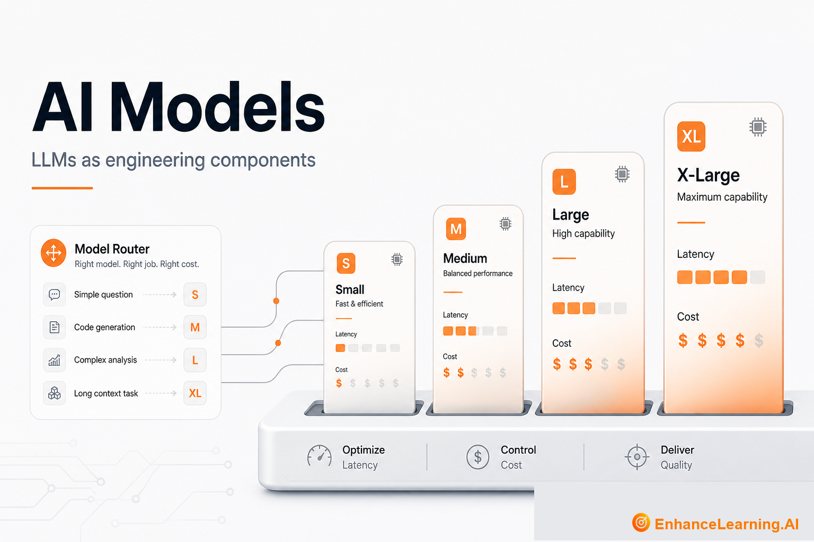

  

# AI Models: Choosing and Operating LLMs as Engineering Components

> Maintained reading path from [EnhanceLearning.AI](https://enhancelearning.ai) — practitioner-grade articles for engineers, architects, and technology leaders building production AI-native systems.

**Topic on the site:** [AI Models](https://enhancelearning.ai/articles?category=AI+Models) · **Full library:** [enhancelearning.ai/articles](https://enhancelearning.ai/articles)

## What this repo is

A curated reading path for **AI Models**. It is not a code SDK — it points to the foundation deep-dives on [EnhanceLearning.AI](https://enhancelearning.ai) so you can align on concepts, critique designs, and ship production systems that hold up.

These articles unpack model size myths, base vs instruction-tuned behaviour, distillation trade-offs, tokenization limits, and practical selection frameworks for enterprise workloads.

## Who it's for

AI engineers, platform teams, and technical leaders accountable for quality and spend.

## Foundation articles

- [The Difference Between a Base LLM and an Instruction-Tuned Model](https://enhancelearning.ai/articles/difference-between-base-llm-and-instruction-tuned-model) — Base models complete text; instruction-tuned models follow directions. That shift changes safety, reliability, and which workloads belong in production.
- [The Role of Tokenization in LLM Behavior and Limitations](https://enhancelearning.ai/articles/role-of-tokenization-in-llm-behavior-and-limitations) — Tokenization shapes cost, context use, multilingual quality, and code handling. Engineers who ignore it mis-size windows and misread model failures.
- [Foundation Model vs Fine-Tuned Derivative: What's Inherited](https://enhancelearning.ai/articles/difference-between-foundation-model-and-fine-tuned-derivative) — Fine-tunes inherit tokenizer, context limits, and blind spots from the parent foundation model. Lineage matters for capability, risk, and vendor claims.
- [Why Model Size is the Wrong Default for AI-Native Design](https://enhancelearning.ai/articles/why-model-size-is-the-wrong-default-for-ai-native-design) — Parameter count is not product quality. Right-size models against task depth, latency envelopes, eval scores, and failure blast radius — not leaderboard rank.
- [Model Architecture Still Shapes Your System, Even Behind an API](https://enhancelearning.ai/articles/model-architecture-still-shapes-your-system-even-behind-an-api) — API access hides weights, not architecture. Transformer design shapes context limits, failure modes, multimodal gaps, and what your system can build.
- [Model Distillation: Teaching Smaller Models to Match Larger Ones](https://enhancelearning.ai/articles/model-distillation-teaching-smaller-models-to-match-larger) — Distillation trains a smaller model to reproduce a larger LLM's behavior. Learn when it cuts cost, when quality collapses, and how to eval the trade-off.
- [Model Selection Framework for Enterprise AI](https://enhancelearning.ai/articles/model-selection-framework-for-enterprise-ai) — A practical framework for choosing enterprise models: task fit, context and tool needs, cost-latency envelopes, eval gates, and when to use routers instead of one frontier model.

## More from EnhanceLearning.AI

- Homepage: [https://enhancelearning.ai](https://enhancelearning.ai)
- All articles: [https://enhancelearning.ai/articles](https://enhancelearning.ai/articles)
- This topic filter: [AI Models](https://enhancelearning.ai/articles?category=AI+Models)
